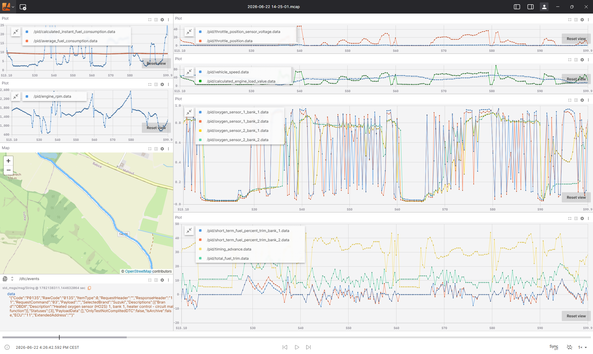

# Car Scanner `.brc` → ROS 2 MCAP converter

`brc_to_mcap.py` converts trip recordings exported by the **Car Scanner** OBD-II
app (proprietary `.brc` binary files) into standard **ROS 2 `.mcap`** bags that
open directly in Foxglove Studio, `ros2 bag` / rosbag2, Lichtblick, PlotJuggler,
etc.

The resulting `.mcap` bag can be replayed and visualized right away in
[Lichtblick](https://lichtblick.dev/) or [Foxglove Studio](https://foxglove.dev/studio) —
just open the file and add panels (Plot, Map, Raw Messages, …) for the topics
listed below.



## Modules

| File | Purpose | Dependencies |
|------|---------|--------------|
| `brc_parser.py` | Decodes the `.brc` binary format into a plain `BrcRecording`. Reusable on its own. | none (stdlib only) |
| `brc_to_mcap.py` | Turns a `BrcRecording` into an MCAP bag; the CLI. | `mcap`, `mcap-ros2-support` |

Use the parser directly in your own code:

```python
from brc_parser import parse_brc
rec = parse_brc("trip.brc")
print(rec.full_name, len(rec.samples), "samples")
```

Or inspect a file from the shell without converting:

```bash
python brc_parser.py trip.brc --list-pids
```

## Install

```bash
pip install mcap mcap-ros2-support
```

## Usage

```bash
# Convert one file (writes 2026-06-22 14-25-01.mcap next to it)
python brc_to_mcap.py "Car scanner export/2026-06-22 14-25-01.brc"

# Convert a whole folder of .brc files into an output directory
python brc_to_mcap.py "Car scanner export" -o mcap_out

# Options
python brc_to_mcap.py INPUT -o OUT --compression zstd|lz4|none
```

## What's in the bag

| Topic | Type | Contents |
|-------|------|----------|
| `/pid/<name>` | `std_msgs/msg/Float64` | one topic per telemetry channel (Engine RPM, coolant temp, boost, fuel trims, …) |
| `/gps/fix` | `sensor_msgs/msg/NavSatFix` | latitude / longitude (Foxglove Map panel reads this directly) |
| `/dtc/events` | `std_msgs/msg/String` | raw diagnostic trouble-code JSON, when present |
| `/session/pid_catalog` | `std_msgs/msg/String` | one-shot JSON mapping each topic slug back to its original PID label |

Vehicle / adapter / session info is also stored in an MCAP `car_scanner`
metadata record (`mcap info` / readers can query it).

Message `log_time` is the recording's wall-clock time. Car Scanner stores a
naive local timestamp; it is written as-is (interpreted as UTC) so the clock
digits match the app and relative timing between samples is exact.

## Format notes / correctness

The `.brc` format is undocumented and was reverse-engineered for this tool (see
the module docstring in `brc_to_mcap.py` for the full byte layout). The decoder
was validated against Car Scanner's own `.csv` export of the same trips: 130
field checks across a full session matched exactly, with sub-millisecond
timestamp agreement.

If a future app version uses different record tags, the parser stops instead of
emitting garbage and prints how much of the file it managed to decode.
